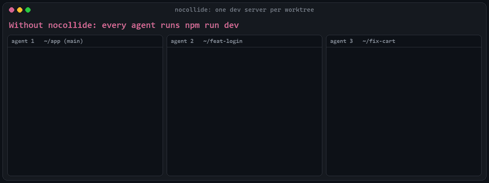

# nocollide

[](https://github.com/zzoraemon043/nocollide/actions/workflows/ci.yml)
[](https://www.npmjs.com/package/nocollide)
[](LICENSE)

**Run 5 coding agents in parallel. Zero port clashes. Zero shared databases. No containers.**



> Status: v0.1 handles ports and `.env` files. Per-slot databases and Docker Compose land in v0.2.

## Install

```bash
npx nocollide init
```

Or install it once with `npm install -g nocollide`. Requires Node.js 22 or newer and git 2.31 or newer. Works on macOS, Linux and Windows.

## The problem

Git worktrees give every agent its own copy of the **files**. They do not give it its own **runtime**:

- Agent A runs `npm run dev` on port 3000. Agent B runs it too: `EADDRINUSE`.
- Both agents run migrations against the same `app_dev` database and break each other's tests.
- `.env` is not copied into new worktrees, so the agent starts without settings, or with the wrong ones.
- Docker Compose project names collide, and one agent's `docker compose down` kills the other's services.

Container-per-agent tools solve this, but they are heavy, slow to start, and replace your whole dev setup. nocollide is the thin layer in between.

## How it works

Each worktree gets a **slot number**. Everything else is derived from it.

```text
main worktree      slot 0   WEB_PORT=3000   API_PORT=4000
../feat-login      slot 1   WEB_PORT=3010   API_PORT=4010
../fix-cart        slot 2   WEB_PORT=3020   API_PORT=4020
```

- The main worktree always keeps slot 0, so your normal setup does not change.
- Other worktrees get the lowest free slot. A slot is skipped when one of its ports is already in use.
- Slots live in `~/.nocollide/slots.json` behind a lock, so ten agents running `up` at the same moment still get ten different slots.

## Usage

```bash
nocollide init            # once per repository: writes nocollide.json
nocollide up              # in a worktree: claims a slot and writes .env.local
nocollide run -- npm run dev   # runs a command with the slot variables set
nocollide port WEB_PORT   # prints one port, handy in scripts
nocollide ls              # every slot of this repository
nocollide down            # releases the slot and removes .env.local
nocollide gc              # releases slots whose worktree was deleted
```

`init` reads ports from `.env.example` (`WEB_PORT=3000`) and from `package.json` scripts (`--port 3000`, `-p 3000`, `PORT=3000`) and writes:

```json
{
  "ports": { "WEB_PORT": 3000, "API_PORT": 4000 },
  "step": 10,
  "env": { "from": ".env.example", "to": ".env.local" }
}
```

Commit `nocollide.json`. Until you do, new worktrees fall back to the copy in the main worktree.

### The env file

`up` copies `env.from` to `env.to`, sets every port variable and `NOCOLLIDE_SLOT`, and fills `${...}` placeholders:

```dotenv
DATABASE_URL=postgres://localhost/app_s${NOCOLLIDE_SLOT}
PUBLIC_URL=http://localhost:${WEB_PORT}
```

nocollide never overwrites an env file it did not write. Move your own values into the template, or pass `--force`.

### Make your dev server use the port

Most frameworks read `PORT` or a variable you pass in config. If a script hard-codes a port, either make it read the variable, or start it through nocollide:

```bash
nocollide run -- npm run dev
```

### Tell your agents

Add one line to `AGENTS.md` or your agent's instructions file:

```text
Before starting a dev server or tests in a worktree, run `npx nocollide up` and use the ports in .env.local.
```

## Non-goals

- Not a worktree manager. Keep using `git worktree`, or your favourite wrapper.
- Not a sandbox. Agents still share your machine; use containers if you need security isolation.

## Roadmap

See [ROADMAP.md](ROADMAP.md).

## License

MIT
